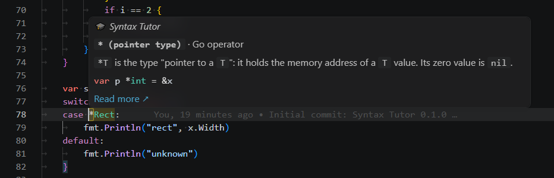
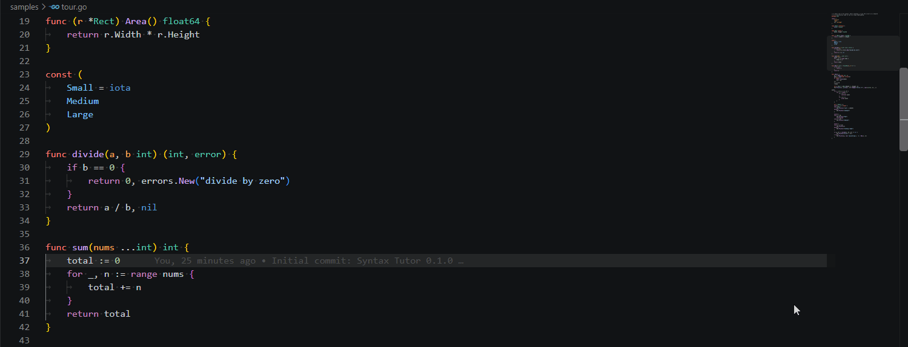
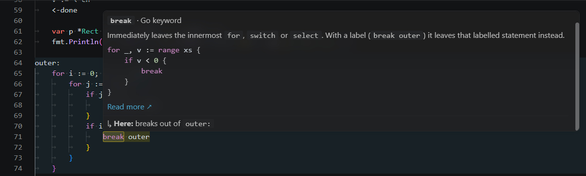
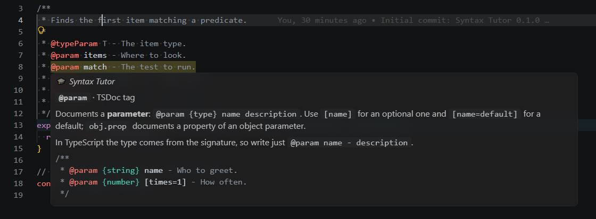
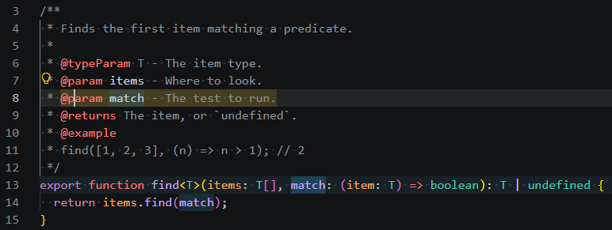
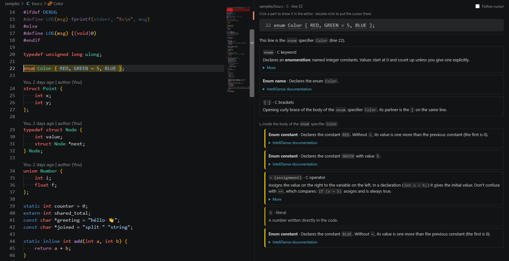

# Syntax Tutor

Learn a programming language while you read code. Hover over a keyword, operator or built-in to see what it means, and see at a glance which block of code it belongs to.

*Disclaimer*: This plugin is 100% vibe-coded.

Supports:
- **Go**
- **Rust**
- **C**
- **C++**
- **C#**
- **JavaScript** and **TypeScript** (including JSX/TSX)
- **Python**

Support for more languages can be added on request. Syntax Tutor parses code with [tree-sitter](https://tree-sitter.github.io/) so any language supported by it can be added easily.

I created it because I mainly work in C# but sometimes also need to do things in Go and Rust.
Their syntax is not top of mind, so when editing or reviewing code in those languages, I sometimes forget what some constructs mean (like the `:=` operator in Go) or where a scope begins and ends. 
This plugin helps with that by highlighting scopes and showing explanation-on-hover for all language constructs such as operators and brackets but also attribute or generics syntax.

## Features

- **Hover explanations.** Hover a piece of syntax to see what it means.

  

  This works on keywords, operators, built-ins, literals and declaration names. You get a short explanation, an example and a link to the official docs. The same token gets a different explanation depending on where it appears: `*` in `*int` (pointer type), `*p` (dereference) and `a * b`, or `<-` as send, receive or channel direction. In an expression with several operators, an operator's hover also shows what it works on and how operator precedence groups the expression: in `a + b * c == d`, `+` combines `a` and `b * c`, grouped as `(a + (b * c)) == d`.

- **Scope highlighting.** See at a glance which construct a keyword belongs to.

  

  Put the cursor on (or hover) a keyword or a declaration name. The construct it belongs to gets a marker-style background, and the opening keyword and closing bracket get an outline (Python blocks have no closing bracket: their indentation ends them). For example, `func`, `fn`, `def` or a function's name highlights the whole function, `else` highlights the whole `if`/`else` chain, and `range` highlights its `for` loop.

- **Jump targets.** See where `return`, `break` and other jumps take you.

  

  For `return`, `break`, `continue`, `goto`, `throw`/`raise`, `yield`/`await` and language-specific jumps (Go's `defer`/`fallthrough`, Rust's `?`), the scope they leave or jump to gets a second, lighter highlight. Labelled loops are followed, and the hover tells you where the jump goes.

- **Comments and doc comments.** Find out what kind of comment you're reading and what its doc tags mean.

  
  

  Hovering a comment says what kind it is: plain, doc comment (JSDoc/TSDoc, Doxygen, C# XML doc, rustdoc `///`/`//!`, Go doc comments, Python docstrings), a directive (`//go:build`, `// @ts-expect-error`, `/// <reference>`, `// NOLINT`, ESLint, `# noqa`, `# type:`, ...) or a `TODO`. The whole comment block is highlighted, and a doc comment also lightly highlights the declaration it documents. Doc tags get their own explanation: `@param`, `\brief`, `<summary>`, `<param name="x">`, Rust `# Examples` / doc tests, Go `Deprecated:`, Python docstring sections (`Args:`, NumPy `Parameters`, Sphinx `:param x:`) and doctests (`>>>`). A tag that names a parameter highlights that parameter, and doc links (`{@link foo}`, `[Name]`, `<see cref="..."/>`) highlight the linked declaration.

- **Explain This Line.** Get every part of a line explained, in order, in a side panel.

  

  Right-click a line (or select several) and choose **Syntax Tutor: Explain This Line**, or press `Ctrl+Shift+Alt+E` (`Cmd+Shift+Alt+E` on Mac). The panel explains every part of the line in reading order: keywords, operators and brackets get their explanation, and plain names say where they are declared ("declared on line 12 as a parameter"). When your language extension (TypeScript, gopls, rust-analyzer, C#, C/C++, Python/Pylance) has documentation for a name or member, the entry gets a collapsed **IntelliSense documentation** section with that doc string; bare signatures like `(local variable) Guid userId` are left out. A sentence at the top says what the line is, for example "This line starts the `for` statement (lines 38–40)". With several lines selected, parts inside a block or branch opened in those lines are indented under a small "inside the body of the `if` statement" header, with a coloured border per nesting level. Hover an entry to highlight it in the editor, click it to scroll there (your selection stays), double-click to put the cursor on it, and turn on **Follow cursor** to keep the panel in step as you move through the code.

Syntax Tutor parses code with [tree-sitter](https://tree-sitter.github.io/), so it needs no language server (gopls, rust-analyzer, clangd, ...). If you do use one, both hovers appear in the same popup, and the Syntax Tutor part starts with **🎓 *Syntax Tutor***.

It also works in VS Code for the web, on [vscode.dev](https://vscode.dev) and [github.dev](https://github.dev) (press `.` on any GitHub repository), so you can use it while reading code on GitHub.

## Commands

Run these from the Command Palette (`Ctrl+Shift+P`, `Cmd+Shift+P` on Mac).

- **Syntax Tutor: Explain This Line** opens the Explain This Line panel for the line the cursor is on, or for all selected lines.

  It's also in the editor's right-click menu, and has the shortcut `Ctrl+Shift+Alt+E` (`Cmd+Shift+Alt+E` on Mac). It works in Go, Rust, C, C++, C#, JavaScript, TypeScript and Python files.

- **Syntax Tutor: Toggle Hover Explanations** turns the hover explanations on or off.

  It changes `syntaxTutor.hover.enabled` in your user settings, so the choice stays in every window and after a restart. The status bar briefly shows whether it's now on or off.

- **Syntax Tutor: Toggle Scope Highlighting** turns the scope and jump-target highlighting on or off.

  It changes `syntaxTutor.scopeHighlight.enabled` in your user settings, so the choice stays in every window and after a restart. The status bar briefly shows whether it's now on or off.

## Settings

| Setting | Default | |
|---|---|---|
| `syntaxTutor.hover.enabled` | `true` | Show hover explanations |
| `syntaxTutor.scopeHighlight.enabled` | `true` | Highlight scopes |
| `syntaxTutor.scopeHighlight.trigger` | `both` | `cursor`, `hover` or `both` |
| `syntaxTutor.scopeHighlight.hoverTimeout` | `4` | Seconds before a hover-started highlight clears itself (`0` = keep it) |
| `syntaxTutor.scopeHighlight.showRelated` | `true` | Lighter highlight for jump targets and documented declarations |
| `syntaxTutor.comments` | `all` | `all`, `doc` (skip plain comments) or `off` |

You can change the colors in `settings.json`:

```json
"workbench.colorCustomizations": {
  "syntaxTutor.scopeBackground": "#ffd70030",
  "syntaxTutor.relatedScopeBackground": "#4fc1ff18",
  "syntaxTutor.scopeBorder": "#ffd70090"
}
```

# Development

The sections below are for working on the extension itself.

## Run from source

```bash
npm install
npm run build
```

Open this folder in VS Code and press **F5** (the "Run Extension" launch config). A new window opens on `samples/`. Open one of the `tour.*` files and start hovering. `samples/comments/` has a file per language that shows the comment and doc-comment features.

To build a `.vsix` and install it in your normal VS Code:

```bash
npm run package
code --install-extension syntax-tutor-0.2.0.vsix
```

To try the web version (as on vscode.dev), run this and open http://localhost:3000. It downloads VS Code for the web the first time.

```bash
npm run web
```

## How it works

| File | What it does |
|---|---|
| `src/docs/<language>.ts` | Everything language-specific: the doc tables, what identifiers mean in context (`role`), and where jumps go (`jumpTarget`) |
| `src/core/analyzer.ts` | Finds the token under the cursor, picks its doc entry, and works out its scope |
| `src/core/comments.ts`, `src/docs/comments.ts` | Comment blocks, doc comments and their tags; the comment kinds and tag docs per language |
| `src/core/brackets.ts` | Explains brackets from their place in the syntax tree |
| `src/core/grouping.ts` | Shows how operator precedence groups an expression, for operator hovers |
| `src/core/parser.ts` | Loads the tree-sitter grammars, each one the first time its language is needed |
| `src/extension.ts` | VS Code wiring: hover provider, decorations, settings |

Doc entries are looked up from most to least specific:

1. `"<parent node type>/<token>"`, for example `"pointer_type/*"`
2. `"<token>"`, for example `"func"`
3. `"#<node type>"`, for literals such as `"#raw_string_literal"`

To find the node type names for a construct, paste some code into the playground on [tree-sitter.github.io](https://tree-sitter.github.io/tree-sitter/), or print `tree.rootNode.toString()`.

### Adding a language

1. Add the grammar package (it should ship a `.wasm` file) and copy the file in `scripts/build.mjs`.
2. Write `src/docs/<lang>.ts`, exporting a `LanguageSpec` (`languageIds` lists the VS Code language ids it handles). For a language with indentation blocks set `indentedBlocks` (see `src/docs/python.ts`); `comments.isDocString` lets string literals act as doc comments, like Python docstrings.
3. Add it to `ALL_SPECS` in `src/extension.ts`, and add `onLanguage:<id>` to `activationEvents`.
4. Add `samples/tour.<ext>` and `test/<lang>.test.mjs`. `node scripts/build.mjs --lang <lang>` rebuilds just that language's test bundle.

## Tests

```bash
npm test             # analyzer tests per language against samples/ (node:test)
npm run test:vscode  # runs the extension in an isolated VS Code instance
npm run web          # runs the extension in VS Code for the web, for trying it by hand
```
